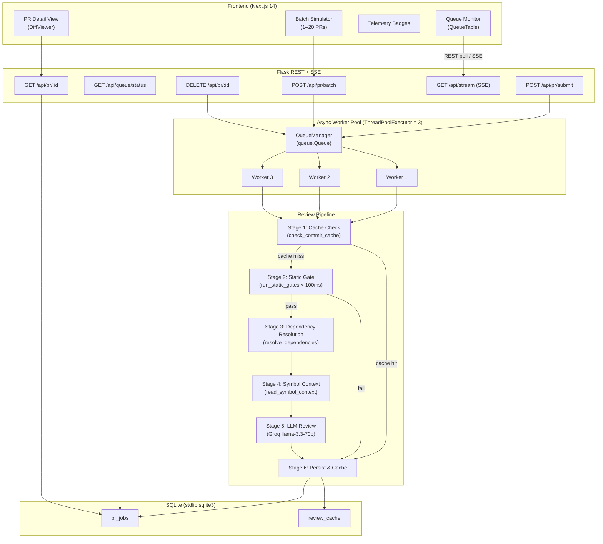
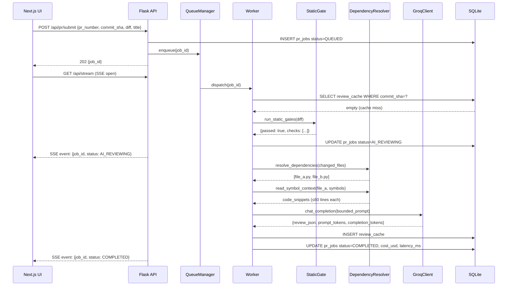
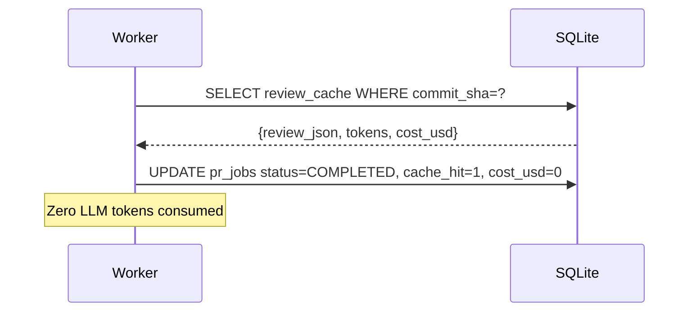
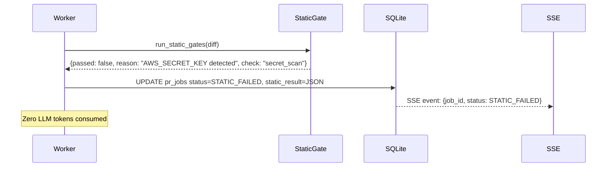
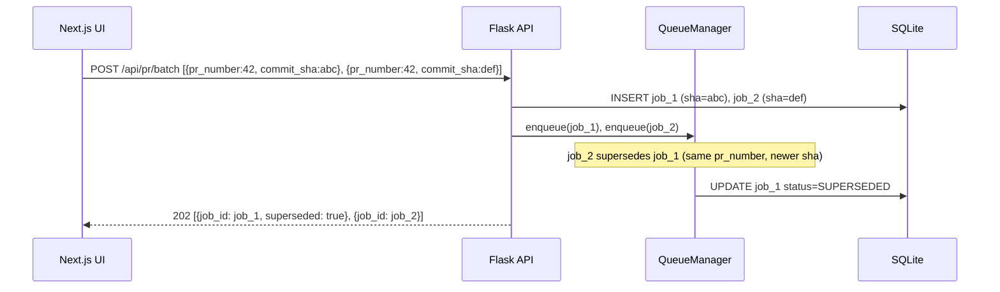

# Design Document: PR Verification Engine

## Overview

The PR Verification Engine is a high-throughput Git pull request review platform built as a 5-hour prototype for ATX Round 2 Build Day. It addresses the core problem of token cost explosion and queue stalling in naive AI code review by routing every PR through a zero-cost deterministic gate before any LLM is invoked.

The system operates as a continuous background service: a Flask backend hosts an async worker pool backed by SQLite, a surgical context-gathering pipeline extracts only the diff and direct dependencies (targeting < 4000 tokens per prompt), and a Next.js 14 frontend provides a live queue monitor with per-PR telemetry. Every PR moves through well-defined lifecycle states — QUEUED → STATIC_FAILED | AI_REVIEWING → COMPLETED | SUPERSEDED — with latency, token counts, and estimated dollar cost tracked at each step.

The central design principle is **cost discipline**: commit-SHA deduplication means identical code is reviewed exactly once, the static gate eliminates LLM spend on trivially broken PRs, and AST-driven context resolution bounds the prompt to the minimal relevant code surface.

## Architecture



## Sequence Diagrams

### Happy-Path Single PR Review



### Cache Hit Path



### Static Gate Failure



### Batch Submit & Supersede



## Components and Interfaces

### Component 1: Flask API (`backend/app.py`)

**Purpose**: HTTP entry point. Validates incoming requests, writes initial `pr_jobs` rows, and delegates to `QueueManager`. Also hosts the SSE stream endpoint.

**Interface**:
```python
# POST /api/pr/submit
def submit_pr() -> tuple[dict, int]:
    # Body: PRSubmitRequest
    # Returns: 202 {"job_id": int} | 400 {"error": str} | 422 {"error": str}
    ...

# POST /api/pr/batch
def submit_batch() -> tuple[dict, int]:
    # Body: list[PRSubmitRequest], max 20 items
    # Returns: 202 {"jobs": list[BatchJobResult]} | 400 | 422
    ...

# GET /api/pr/<int:job_id>
def get_pr(job_id: int) -> tuple[dict, int]:
    # Returns: 200 PRJobDetail | 404
    ...

# GET /api/queue/status
def queue_status() -> tuple[dict, int]:
    # Returns: 200 QueueStatusResponse
    ...

# GET /api/stream
def sse_stream() -> Response:
    # Returns: text/event-stream, infinite SSE
    ...

# DELETE /api/pr/<int:job_id>
def cancel_pr(job_id: int) -> tuple[dict, int]:
    # Returns: 200 {"cancelled": True} | 404 | 409 {"error": "already_terminal"}
    ...
```

**Responsibilities**:
- Input validation and 400/422 error responses
- Initial DB write before enqueue (ensures job is visible immediately)
- SSE connection registry management

### Component 2: QueueManager (`backend/queue_manager.py`)

**Purpose**: Manages the `queue.Queue`, the `ThreadPoolExecutor` with 3 workers, supersede logic, and job cancellation.

**Interface**:
```python
class QueueManager:
    def __init__(self, db: Database, num_workers: int = 3) -> None: ...

    def enqueue(self, job_id: int) -> None:
        # Adds job_id to queue; checks for active jobs on same pr_number
        ...

    def cancel(self, job_id: int) -> bool:
        # Marks job SUPERSEDED if still QUEUED; returns False if already terminal
        ...

    def get_worker_status(self) -> list[WorkerStatus]:
        # Returns current state of each worker thread
        ...

    def _worker_loop(self) -> None:
        # Runs in each thread: pulls from queue, runs pipeline, handles retries
        ...
```

**Responsibilities**:
- Supersede detection: when a new job arrives for `pr_number` N, any existing `QUEUED` job for N is set to `SUPERSEDED`
- Exponential backoff: catches `GroqRateLimitError`, sleeps 2^attempt seconds (max 32s), retries up to 5 times
- Thread-safe job state transitions via DB transactions

### Component 3: Database (`backend/db.py`)

**Purpose**: All SQLite operations, schema initialization, and row mapping.

**Interface**:
```python
class Database:
    def __init__(self, db_path: str = "pr_engine.db") -> None: ...

    def init_schema(self) -> None: ...

    def insert_job(self, job: PRJobInsert) -> int:
        # Returns new job_id
        ...

    def update_job_status(self, job_id: int, status: PRStatus, **fields) -> None: ...

    def get_job(self, job_id: int) -> PRJobRow | None: ...

    def get_all_jobs(self) -> list[PRJobRow]: ...

    def get_cache(self, commit_sha: str) -> CacheRow | None: ...

    def insert_cache(self, row: CacheInsert) -> None: ...

    def get_queued_jobs_for_pr(self, pr_number: int) -> list[PRJobRow]: ...
```

**Responsibilities**:
- Thread-safe access via `check_same_thread=False` and `threading.Lock`
- Schema creation on first run
- All time fields stored as ISO-8601 UTC strings; `latency_ms` computed by the worker

### Component 4: Static Gate (`backend/pipeline/static_gate.py`)

**Purpose**: Runs deterministic zero-cost checks on the raw diff string in under 100 ms. Returns pass/fail plus structured findings.

**Interface**:
```python
@dataclass
class GateResult:
    passed: bool
    checks: list[CheckResult]  # one entry per check that ran
    duration_ms: float

@dataclass
class CheckResult:
    name: str           # "secret_scan" | "syntax_check"
    passed: bool
    findings: list[str] # human-readable findings on failure

def run_static_gates(diff: str, repo_root: str | None = None) -> GateResult:
    # Runs all checks; short-circuits on first failure
    ...

def _scan_secrets(diff: str) -> CheckResult: ...

def _check_syntax(diff: str) -> CheckResult: ...
```

**Responsibilities**:
- Secret scan: regex matching for AWS access keys, JWT tokens, generic API keys, private key headers
- Syntax check: extracts `+` lines from diff, reconstructs added Python code blocks, calls `ast.parse`
- Timing: wraps execution in `time.perf_counter()` for `duration_ms`

### Component 5: Dependency Resolver (`backend/pipeline/dependency.py`)

**Purpose**: Given a list of changed files, returns a minimal ordered list (max 3 files) of directly imported modules found in the sample repo.

**Interface**:
```python
def resolve_dependencies(
    changed_files: list[str],
    repo_root: str = "sample_repo"
) -> list[str]:
    # Returns absolute paths of resolved dependency files, capped at 3
    ...

def _extract_imports(source: str) -> list[str]:
    # Uses ast.parse to extract top-level import names
    ...

def _resolve_local(import_name: str, repo_root: str) -> str | None:
    # Maps import name to a file in repo_root if it exists
    ...
```

**Responsibilities**:
- Only resolves imports that exist as files in `sample_repo/` (no stdlib or third-party traversal)
- Returns at most 3 dependency file paths to bound context size
- Silently skips files that cannot be parsed

### Component 6: Context Builder (`backend/pipeline/context_builder.py`)

**Purpose**: Extracts specific function or class snippets from Python source files using AST node visiting. Caps output at 60 lines per symbol.

**Interface**:
```python
@dataclass
class SymbolContext:
    file: str
    symbol: str
    source_lines: list[str]   # at most 60 lines
    start_line: int
    end_line: int

def read_symbol_context(
    file_path: str,
    symbols: list[str]
) -> list[SymbolContext]:
    # Returns one SymbolContext per resolved symbol
    ...

def build_context_prompt(
    diff: str,
    symbol_contexts: list[SymbolContext]
) -> str:
    # Assembles the final prompt string; asserts total tokens < 4000
    ...
```

**Responsibilities**:
- Visits AST to locate `FunctionDef`, `AsyncFunctionDef`, `ClassDef` nodes by name
- Extracts source lines via `inspect.getsourcelines` equivalent using `ast.get_source_segment`
- `build_context_prompt` assembles: system instructions + unified diff + code snippets; estimates token count via `len(text) // 4`

### Component 7: Groq Client (`backend/llm/groq_client.py`)

**Purpose**: Wraps the Groq HTTP API, structures the prompt, parses the JSON review response, and computes cost.

**Interface**:
```python
@dataclass
class LLMReview:
    summary: str
    findings: list[Finding]
    severity: str           # "low" | "medium" | "high" | "critical"
    prompt_tokens: int
    completion_tokens: int
    cost_usd: float

@dataclass
class Finding:
    file: str
    line: int | None
    severity: str
    message: str

class GroqClient:
    def __init__(self, api_key: str, model: str = "llama-3.3-70b-versatile") -> None: ...

    def review(self, prompt: str) -> LLMReview:
        # Raises GroqRateLimitError on 429; raises GroqAPIError on other failures
        ...

    def _compute_cost(self, prompt_tokens: int, completion_tokens: int) -> float:
        # Applies per-model token pricing
        ...
```

**Responsibilities**:
- Instructs the model via system prompt to return valid JSON only
- Parses and validates the JSON response; falls back to `{summary: raw_text, findings: []}` on parse failure
- Cost: llama-3.3-70b-versatile pricing applied per-token (input + output rates)

### Component 8: Models (`backend/models.py`)

**Purpose**: Shared dataclasses and enums used across all backend modules.

```python
from enum import Enum
from dataclasses import dataclass

class PRStatus(str, Enum):
    QUEUED         = "QUEUED"
    STATIC_FAILED  = "STATIC_FAILED"
    AI_REVIEWING   = "AI_REVIEWING"
    COMPLETED      = "COMPLETED"
    SUPERSEDED     = "SUPERSEDED"

@dataclass
class PRSubmitRequest:
    pr_number: int
    title: str
    commit_sha: str   # 40-char hex SHA
    diff: str         # unified diff string
    files: list[str]  # list of changed file paths

@dataclass
class PRJobRow:
    id: int
    pr_number: int
    title: str
    commit_sha: str
    diff: str
    status: PRStatus
    static_result: dict | None
    review: dict | None
    prompt_tokens: int | None
    completion_tokens: int | None
    cost_usd: float | None
    queued_at: str
    started_at: str | None
    completed_at: str | None
    latency_ms: int | None
    cache_hit: bool
```

## Data Models

### SQLite: `pr_jobs`

| Column | Type | Notes |
|---|---|---|
| `id` | INTEGER PK AUTOINCREMENT | |
| `pr_number` | INTEGER NOT NULL | GitHub PR number |
| `title` | TEXT NOT NULL | |
| `commit_sha` | TEXT NOT NULL | 40-char hex |
| `diff` | TEXT NOT NULL | Full unified diff |
| `status` | TEXT NOT NULL | `PRStatus` enum value |
| `static_result` | TEXT | JSON blob or NULL |
| `review` | TEXT | JSON blob or NULL |
| `prompt_tokens` | INTEGER | NULL until LLM runs |
| `completion_tokens` | INTEGER | NULL until LLM runs |
| `cost_usd` | REAL | NULL until completed |
| `queued_at` | TEXT NOT NULL | ISO-8601 UTC |
| `started_at` | TEXT | ISO-8601 UTC or NULL |
| `completed_at` | TEXT | ISO-8601 UTC or NULL |
| `latency_ms` | INTEGER | `completed_at - started_at` |
| `cache_hit` | INTEGER | 0 or 1 |

**Indices**: `CREATE INDEX idx_pr_jobs_pr_number ON pr_jobs(pr_number)`, `CREATE INDEX idx_pr_jobs_status ON pr_jobs(status)`

### SQLite: `review_cache`

| Column | Type | Notes |
|---|---|---|
| `commit_sha` | TEXT PRIMARY KEY | |
| `review` | TEXT NOT NULL | JSON blob |
| `prompt_tokens` | INTEGER NOT NULL | |
| `completion_tokens` | INTEGER NOT NULL | |
| `cost_usd` | REAL NOT NULL | |
| `created_at` | TEXT NOT NULL | ISO-8601 UTC |

### Frontend API Types (`frontend/lib/api.ts`)

```typescript
export type PRStatus =
  | "QUEUED"
  | "STATIC_FAILED"
  | "AI_REVIEWING"
  | "COMPLETED"
  | "SUPERSEDED";

export interface PRJob {
  id: number;
  pr_number: number;
  title: string;
  commit_sha: string;
  status: PRStatus;
  cache_hit: boolean;
  latency_ms: number | null;
  prompt_tokens: number | null;
  completion_tokens: number | null;
  cost_usd: number | null;
  queued_at: string;
  completed_at: string | null;
}

export interface PRJobDetail extends PRJob {
  diff: string;
  static_result: StaticResult | null;
  review: ReviewResult | null;
}

export interface ReviewResult {
  summary: string;
  findings: Finding[];
  severity: "low" | "medium" | "high" | "critical";
}

export interface Finding {
  file: string;
  line: number | null;
  severity: string;
  message: string;
}

export interface QueueStatus {
  workers: WorkerStatus[];
  jobs: PRJob[];
  aggregate: Aggregate;
}

export interface WorkerStatus {
  worker_id: number;
  status: "idle" | "busy";
  current_job_id: number | null;
}

export interface Aggregate {
  total_jobs: number;
  completed: number;
  static_failed: number;
  cache_hits: number;
  total_cost_usd: number;
  avg_latency_ms: number | null;
}
```

## Algorithmic Pseudocode

### Main Worker Loop

```python
def _worker_loop(worker_id: int, job_queue: queue.Queue, db: Database) -> None:
    """
    Preconditions:
      - job_queue is a thread-safe queue.Queue
      - db connection is opened with check_same_thread=False
    Postconditions:
      - Every job_id dequeued transitions to a terminal state
        (COMPLETED, STATIC_FAILED, or SUPERSEDED)
      - No job_id is left in AI_REVIEWING on worker exit
    Loop Invariant:
      - At top of each iteration, worker state is "idle" in worker registry
    """
    while True:
        job_id = job_queue.get()           # blocks until item available
        
        if job_id is _SHUTDOWN_SENTINEL:
            job_queue.task_done()
            return

        mark_worker_busy(worker_id, job_id)
        
        try:
            job = db.get_job(job_id)
            
            if job.status == PRStatus.SUPERSEDED:
                continue                   # already cancelled, skip silently
            
            _run_pipeline(job, db, worker_id)
            
        except Exception as exc:
            db.update_job_status(job_id, PRStatus.STATIC_FAILED,
                                 static_result={"error": str(exc)})
        finally:
            mark_worker_idle(worker_id)
            job_queue.task_done()
```

### Full Pipeline Execution

```python
def _run_pipeline(job: PRJobRow, db: Database, worker_id: int) -> None:
    """
    Preconditions:
      - job.status is QUEUED
      - job.commit_sha is a valid 40-char hex string
    Postconditions:
      - job transitions to exactly one terminal status
      - If COMPLETED and cache_hit=False: review_cache contains job.commit_sha
      - cost_usd = 0 for cache hits and STATIC_FAILED jobs
    """
    t_start = time.perf_counter()

    # Stage 1: Cache check
    cached = db.get_cache(job.commit_sha)
    if cached is not None:
        db.update_job_status(
            job.id, PRStatus.COMPLETED,
            review=cached.review,
            prompt_tokens=cached.prompt_tokens,
            completion_tokens=cached.completion_tokens,
            cost_usd=0.0,
            cache_hit=True,
            latency_ms=int((time.perf_counter() - t_start) * 1000)
        )
        emit_sse_event(job.id, PRStatus.COMPLETED)
        return

    # Stage 2: Static gate
    gate_result = run_static_gates(job.diff)
    if not gate_result.passed:
        db.update_job_status(
            job.id, PRStatus.STATIC_FAILED,
            static_result=dataclasses.asdict(gate_result),
            cost_usd=0.0,
            latency_ms=int((time.perf_counter() - t_start) * 1000)
        )
        emit_sse_event(job.id, PRStatus.STATIC_FAILED)
        return

    # Stage 3: Mark AI_REVIEWING
    db.update_job_status(job.id, PRStatus.AI_REVIEWING,
                         started_at=utcnow_iso())
    emit_sse_event(job.id, PRStatus.AI_REVIEWING)

    # Stage 4: Dependency resolution
    dep_files = resolve_dependencies(job.files, repo_root="sample_repo")

    # Stage 5: Symbol context extraction
    all_symbols = _extract_symbols_from_diff(job.diff)
    symbol_contexts = []
    for dep_file in dep_files:
        symbol_contexts.extend(
            read_symbol_context(dep_file, all_symbols)
        )

    # Stage 6: Prompt assembly
    prompt = build_context_prompt(job.diff, symbol_contexts)

    # Stage 7: LLM call with exponential backoff
    llm_review = _call_llm_with_backoff(prompt, max_retries=5)

    # Stage 8: Persist
    latency_ms = int((time.perf_counter() - t_start) * 1000)
    db.insert_cache(CacheInsert(
        commit_sha=job.commit_sha,
        review=dataclasses.asdict(llm_review),
        prompt_tokens=llm_review.prompt_tokens,
        completion_tokens=llm_review.completion_tokens,
        cost_usd=llm_review.cost_usd
    ))
    db.update_job_status(
        job.id, PRStatus.COMPLETED,
        review=dataclasses.asdict(llm_review),
        prompt_tokens=llm_review.prompt_tokens,
        completion_tokens=llm_review.completion_tokens,
        cost_usd=llm_review.cost_usd,
        cache_hit=False,
        latency_ms=latency_ms
    )
    emit_sse_event(job.id, PRStatus.COMPLETED)
```

### Exponential Backoff for LLM

```python
def _call_llm_with_backoff(
    prompt: str,
    max_retries: int = 5
) -> LLMReview:
    """
    Preconditions:
      - prompt is a non-empty string
      - max_retries >= 1
    Postconditions:
      - Returns LLMReview on success
      - Raises GroqAPIError after max_retries exhausted
    Loop Invariant:
      - attempt <= max_retries at top of each iteration
    """
    client = GroqClient(api_key=os.environ["GROQ_API_KEY"])
    
    for attempt in range(max_retries):
        # Loop invariant: attempt in [0, max_retries)
        try:
            return client.review(prompt)
        except GroqRateLimitError:
            if attempt == max_retries - 1:
                raise
            sleep_seconds = min(2 ** attempt, 32)   # cap at 32s
            time.sleep(sleep_seconds)
        except GroqAPIError:
            raise    # non-rate-limit errors are not retried
    
    raise GroqAPIError("max_retries exhausted")
```

### Secret Scanning Algorithm

```python
# Patterns compiled once at module load (performance)
_SECRET_PATTERNS: list[tuple[str, re.Pattern]] = [
    ("AWS_ACCESS_KEY",   re.compile(r'AKIA[0-9A-Z]{16}')),
    ("AWS_SECRET_KEY",   re.compile(r'(?i)aws.{0,20}secret.{0,20}[\'"][0-9a-zA-Z/+]{40}[\'"]')),
    ("JWT_TOKEN",        re.compile(r'eyJ[A-Za-z0-9_-]{10,}\.[A-Za-z0-9_-]{10,}\.[A-Za-z0-9_-]{10,}')),
    ("API_KEY_GENERIC",  re.compile(r'(?i)(api_key|apikey|api-key)\s*[=:]\s*[\'"][A-Za-z0-9_\-]{16,}[\'"]')),
    ("PRIVATE_KEY",      re.compile(r'-----BEGIN (RSA |EC |OPENSSH )?PRIVATE KEY-----')),
]

def _scan_secrets(diff: str) -> CheckResult:
    """
    Preconditions:
      - diff is a string (may be empty)
    Postconditions:
      - passed=True iff no pattern matched any added line
      - findings contains one entry per match, with line number and pattern name
    """
    findings: list[str] = []
    
    for line_num, line in enumerate(diff.splitlines(), start=1):
        if not line.startswith("+"):      # only scan added lines
            continue
        for pattern_name, pattern in _SECRET_PATTERNS:
            if pattern.search(line):
                findings.append(
                    f"Line {line_num}: {pattern_name} detected"
                )
    
    return CheckResult(
        name="secret_scan",
        passed=len(findings) == 0,
        findings=findings
    )
```

### AST Syntax Check Algorithm

```python
def _check_syntax(diff: str) -> CheckResult:
    """
    Preconditions:
      - diff is a unified diff string
    Postconditions:
      - passed=True iff all reconstructed Python code blocks parse without error
      - findings contains ast.parse error messages on failure
    """
    findings: list[str] = []
    added_lines: list[str] = []

    for line in diff.splitlines():
        if line.startswith("+++"):
            # flush previous file block
            if added_lines:
                _try_parse_block(added_lines, findings)
            added_lines = []
        elif line.startswith("+") and not line.startswith("+++"):
            added_lines.append(line[1:])   # strip leading "+"

    if added_lines:
        _try_parse_block(added_lines, findings)

    return CheckResult(
        name="syntax_check",
        passed=len(findings) == 0,
        findings=findings
    )

def _try_parse_block(lines: list[str], findings: list[str]) -> None:
    source = "\n".join(lines)
    try:
        ast.parse(source)
    except SyntaxError as e:
        findings.append(f"SyntaxError at line {e.lineno}: {e.msg}")
```

### Dependency Resolution Algorithm

```python
def resolve_dependencies(
    changed_files: list[str],
    repo_root: str = "sample_repo"
) -> list[str]:
    """
    Preconditions:
      - changed_files is a list of relative file paths
      - repo_root is a directory on disk
    Postconditions:
      - Returns a list of resolved absolute file paths, len <= 3
      - Only returns files that exist within repo_root
    Loop Invariant:
      - resolved set grows monotonically; never exceeds 3 items
    """
    resolved: list[str] = []
    seen: set[str] = set()

    for file_path in changed_files:
        if len(resolved) >= 3:
            break
        
        full_path = os.path.join(repo_root, file_path)
        if not os.path.exists(full_path):
            continue
        
        try:
            source = Path(full_path).read_text(encoding="utf-8")
            imports = _extract_imports(source)
        except (OSError, SyntaxError):
            continue
        
        for import_name in imports:
            # Loop invariant: len(resolved) <= 3
            if len(resolved) >= 3:
                break
            dep_path = _resolve_local(import_name, repo_root)
            if dep_path and dep_path not in seen:
                seen.add(dep_path)
                resolved.append(dep_path)
    
    return resolved


def _extract_imports(source: str) -> list[str]:
    tree = ast.parse(source)
    names: list[str] = []
    for node in ast.walk(tree):
        if isinstance(node, ast.Import):
            names.extend(alias.name for alias in node.names)
        elif isinstance(node, ast.ImportFrom) and node.module:
            names.append(node.module.split(".")[0])
    return names
```

### Symbol Context Extraction

```python
def read_symbol_context(
    file_path: str,
    symbols: list[str]
) -> list[SymbolContext]:
    """
    Preconditions:
      - file_path is a readable Python source file
      - symbols is a list of function/class name strings
    Postconditions:
      - Returns one SymbolContext per symbol found in file_path
      - Each SymbolContext.source_lines has at most 60 lines
    """
    source = Path(file_path).read_text(encoding="utf-8")
    source_lines = source.splitlines()
    tree = ast.parse(source)
    
    contexts: list[SymbolContext] = []
    
    for node in ast.walk(tree):
        if not isinstance(node, (ast.FunctionDef, ast.AsyncFunctionDef, ast.ClassDef)):
            continue
        if node.name not in symbols:
            continue
        
        start = node.lineno - 1          # 0-indexed
        end   = node.end_lineno          # exclusive
        
        # Cap at 60 lines
        if end - start > 60:
            end = start + 60
        
        contexts.append(SymbolContext(
            file=file_path,
            symbol=node.name,
            source_lines=source_lines[start:end],
            start_line=node.lineno,
            end_line=min(node.end_lineno, node.lineno + 59)
        ))
    
    return contexts
```

### SSE Event Emission

```python
# Module-level: thread-safe subscriber registry
_sse_queues: list[queue.Queue] = []
_sse_lock = threading.Lock()

def emit_sse_event(job_id: int, status: PRStatus) -> None:
    """
    Preconditions: job_id > 0
    Postconditions: event JSON is placed into every active subscriber queue
    """
    payload = json.dumps({"job_id": job_id, "status": status.value,
                          "ts": utcnow_iso()})
    event = f"data: {payload}\n\n"
    with _sse_lock:
        for q in list(_sse_queues):
            q.put_nowait(event)

def sse_stream() -> Response:
    """Flask route: streams events until client disconnects."""
    client_q: queue.Queue = queue.Queue()
    with _sse_lock:
        _sse_queues.append(client_q)
    
    def generate():
        try:
            while True:
                try:
                    yield client_q.get(timeout=15)
                except queue.Empty:
                    yield ": keepalive\n\n"
        finally:
            with _sse_lock:
                _sse_queues.remove(client_q)
    
    return Response(stream_with_context(generate()),
                    mimetype="text/event-stream")
```

## Key Functions with Formal Specifications

### `enqueue(job_id)` — QueueManager

```python
def enqueue(self, job_id: int) -> None:
```

**Preconditions**:
- `job_id` exists in `pr_jobs` with status `QUEUED`
- `self._queue` is a live `queue.Queue` instance

**Postconditions**:
- `job_id` is in the internal queue
- Any prior `QUEUED` job with the same `pr_number` has status `SUPERSEDED`
- At most one `QUEUED` or `AI_REVIEWING` job exists per `pr_number` after this call

**Loop Invariants**: None (no loops in this function)

### `run_static_gates(diff)` — StaticGate

```python
def run_static_gates(diff: str, repo_root: str | None = None) -> GateResult:
```

**Preconditions**:
- `diff` is a string (may be empty)

**Postconditions**:
- `result.duration_ms < 100` under normal load
- `result.passed == True` iff all individual checks passed
- `result.checks` contains exactly one `CheckResult` per registered check
- If `result.passed == False`, `result.checks` contains at least one entry with `passed == False`

**Loop Invariants**: N/A

### `build_context_prompt(diff, symbol_contexts)` — ContextBuilder

```python
def build_context_prompt(diff: str, symbol_contexts: list[SymbolContext]) -> str:
```

**Preconditions**:
- `diff` is a non-empty unified diff string
- Each `SymbolContext.source_lines` has at most 60 lines

**Postconditions**:
- Returns a string where `len(result) // 4 < 4000` (token estimate)
- Result contains the full `diff` and all `symbol_contexts` that fit within the token budget
- If budget would be exceeded, symbol contexts are truncated (not the diff)

**Loop Invariants**: Token budget monotonically decreases as symbol contexts are appended

### `GroqClient.review(prompt)` — GroqClient

```python
def review(self, prompt: str) -> LLMReview:
```

**Preconditions**:
- `self.api_key` is a non-empty string
- `prompt` is a non-empty string with estimated tokens < 4000

**Postconditions**:
- On success: returns valid `LLMReview` with `prompt_tokens > 0` and `completion_tokens > 0`
- On HTTP 429: raises `GroqRateLimitError`
- On other HTTP errors: raises `GroqAPIError`
- `cost_usd == prompt_tokens * INPUT_RATE + completion_tokens * OUTPUT_RATE`

## Example Usage

### Single PR Submission

```python
import requests

response = requests.post("http://localhost:5000/api/pr/submit", json={
    "pr_number": 42,
    "title": "Add payment retry logic",
    "commit_sha": "a1b2c3d4e5f6a1b2c3d4e5f6a1b2c3d4e5f6a1b2",
    "diff": "--- a/payments.py\n+++ b/payments.py\n@@ -10,6 +10,10 @@\n+def retry_payment(txn_id: str) -> bool:\n+    ...",
    "files": ["payments.py"]
})
# → 202 {"job_id": 7}

# Poll SSE for status changes
import sseclient
events = sseclient.SSEClient("http://localhost:5000/api/stream")
for event in events:
    data = json.loads(event.data)
    # → {"job_id": 7, "status": "AI_REVIEWING", "ts": "2024-01-15T10:30:00Z"}
    # → {"job_id": 7, "status": "COMPLETED",   "ts": "2024-01-15T10:30:03Z"}
```

### Batch Submission (Simulator)

```python
batch_prs = [
    {"pr_number": i, "title": f"PR {i}", "commit_sha": sha_for(i),
     "diff": diff_for(i), "files": [f"file_{i}.py"]}
    for i in range(1, 21)
]
response = requests.post("http://localhost:5000/api/pr/batch",
                         json=batch_prs)
# → 202 {"jobs": [{"job_id": 1, "superseded": False}, ...]}
```

### Direct Pipeline Call (Testing)

```python
from pipeline.static_gate import run_static_gates
from pipeline.dependency import resolve_dependencies
from pipeline.context_builder import build_context_prompt, read_symbol_context

diff = open("tests/fixtures/sample.diff").read()
gate = run_static_gates(diff)
assert gate.passed, gate.checks

deps = resolve_dependencies(["payments.py"], repo_root="sample_repo")
# → ["sample_repo/utils.py"]

contexts = read_symbol_context("sample_repo/utils.py", ["validate_card"])
prompt = build_context_prompt(diff, contexts)
assert len(prompt) // 4 < 4000
```

## Correctness Properties

### Property 1: Every job reaches a terminal state

**Validates: Requirements 1.3**

For all job IDs ever enqueued, the job eventually transitions to a status in `{COMPLETED, STATIC_FAILED, SUPERSEDED}`. No job remains in `{QUEUED, AI_REVIEWING}` indefinitely.

```python
assert all(
    job.status in {PRStatus.COMPLETED, PRStatus.STATIC_FAILED, PRStatus.SUPERSEDED}
    for job in db.get_all_jobs()
    if job.queued_at < threshold_time
)
```

### Property 2: Static gate never costs tokens

**Validates: Requirements 3.1**

For all `STATIC_FAILED` jobs, `prompt_tokens` is `None` and `cost_usd` is `0.0`. The LLM is never invoked when the static gate fails.

```python
assert all(
    job.prompt_tokens is None and job.cost_usd == 0.0
    for job in db.get_all_jobs()
    if job.status == PRStatus.STATIC_FAILED
)
```

### Property 3: Cache hits have zero cost

**Validates: Requirements 4.1**

For all `COMPLETED` jobs where `cache_hit=True`, the recorded `cost_usd` is exactly `0.0`. Token pricing is only applied when the LLM was actually called.

```python
assert all(
    job.cost_usd == 0.0 and job.cache_hit is True
    for job in db.get_all_jobs()
    if job.status == PRStatus.COMPLETED and job.cache_hit
)
```

### Property 4: Same commit SHA produces same review

**Validates: Requirements 4.2**

For any two `COMPLETED` non-superseded jobs sharing the same `commit_sha`, their `review.summary` fields are identical (the second job read from cache).

```python
sha_groups = group_by(jobs, lambda j: j.commit_sha)
for sha, group in sha_groups.items():
    completed = [j for j in group if j.status == PRStatus.COMPLETED]
    if len(completed) > 1:
        reviews = [j.review["summary"] for j in completed]
        assert len(set(reviews)) == 1
```

### Property 5: Static gate completes in under 100 ms

**Validates: Requirements 3.1**

For all jobs where `static_result` is populated, the recorded `duration_ms` is less than 100.

```python
assert all(
    job.static_result["duration_ms"] < 100
    for job in db.get_all_jobs()
    if job.static_result is not None
)
```

### Property 6: Prompt token count stays under 4000

**Validates: Requirements 5.3**

For all `COMPLETED` jobs where `cache_hit=False`, the recorded `prompt_tokens` is less than 4000.

```python
assert all(
    job.prompt_tokens < 4000
    for job in db.get_all_jobs()
    if job.status == PRStatus.COMPLETED and not job.cache_hit
)
```

### Property 7: At most one active job per pr_number

**Validates: Requirements 2.2**

At any point in time, no two jobs sharing the same `pr_number` are simultaneously in `{QUEUED, AI_REVIEWING}` state.

```python
active_statuses = {PRStatus.QUEUED, PRStatus.AI_REVIEWING}
active_jobs = [j for j in db.get_all_jobs() if j.status in active_statuses]
pr_numbers = [j.pr_number for j in active_jobs]
assert len(pr_numbers) == len(set(pr_numbers))
```

## Error Handling

### Scenario 1: Groq Rate Limit (HTTP 429)

**Condition**: `GroqClient.review()` receives HTTP 429  
**Response**: Raise `GroqRateLimitError`; worker catches it and retries with exponential backoff: sleep 1s, 2s, 4s, 8s, 16s (max 32s), up to 5 attempts  
**Recovery**: After successful retry, pipeline continues normally. After 5 failures, job transitions to `STATIC_FAILED` with `static_result.error = "rate_limit_exhausted"`

### Scenario 2: Groq API Error (non-429)

**Condition**: `GroqClient.review()` receives non-retryable HTTP error (500, 503, etc.)  
**Response**: Raise `GroqAPIError`; worker catches it, marks job `STATIC_FAILED` with error detail  
**Recovery**: Job is terminal; user may resubmit

### Scenario 3: LLM Returns Invalid JSON

**Condition**: `GroqClient._parse_response()` fails to decode JSON from model output  
**Response**: Fall back to `LLMReview(summary=raw_text, findings=[], severity="low", ...)`  
**Recovery**: Review is stored and surfaced as a plain text summary in the UI

### Scenario 4: Static Gate Exceeds 100 ms

**Condition**: `run_static_gates` takes longer than expected (large diff, slow I/O)  
**Response**: Result is returned with the actual `duration_ms`; no truncation or timeout  
**Recovery**: Logged as a warning; correctness property P5 violation is surfaced in telemetry

### Scenario 5: Dependency File Not Parseable

**Condition**: `resolve_dependencies` encounters a file with a `SyntaxError` or binary content  
**Response**: Skip that file silently; continue with remaining changed files  
**Recovery**: LLM receives fewer context snippets but still runs with the diff

### Scenario 6: Job Cancelled Mid-Review

**Condition**: `DELETE /api/pr/:id` arrives while job status is `AI_REVIEWING`  
**Response**: Return `409 {"error": "already_terminal"}` — job is not interrupted  
**Recovery**: The LLM call completes; result is persisted. Only `QUEUED` jobs can be cancelled

### Scenario 7: Batch Exceeds 20 PRs

**Condition**: `POST /api/pr/batch` body contains more than 20 items  
**Response**: Return `422 {"error": "batch_size_exceeded", "max": 20, "received": N}`  
**Recovery**: Client must split into smaller batches

## Testing Strategy

### Unit Testing Approach

Each pipeline stage is tested in isolation with deterministic inputs:

- `test_static_gate.py`: fixture diffs with known secrets, known syntax errors, clean diffs — assert `GateResult.passed` and `findings` content
- `test_dependency.py`: mock `sample_repo/` directory tree — assert resolved file lists against known imports
- `test_context_builder.py`: real Python source files — assert `source_lines` length ≤ 60, token estimate < 4000
- `test_groq_client.py`: mock HTTP responses (200, 429, 500) — assert backoff timing, `LLMReview` fields, cost calculation
- `test_db.py`: in-memory SQLite — assert insert/update/query round-trips and status transitions
- `test_queue_manager.py`: inject mock pipeline — assert supersede logic, worker count, job ordering

### Property-Based Testing Approach

**Property Test Library**: `hypothesis`

Key properties to test with generated inputs:

- **Secret scan completeness**: For any string containing a known secret pattern on a `+` line, `_scan_secrets` always returns `passed=False`
- **Symbol context cap**: For any Python source file and symbol list, `read_symbol_context` always returns `source_lines` with length ≤ 60
- **Token budget**: For any diff and any set of symbol contexts satisfying preconditions, `build_context_prompt` returns a string where `len // 4 < 4000`
- **Supersede invariant**: For any sequence of `enqueue` calls for the same `pr_number`, at most one job is in `{QUEUED, AI_REVIEWING}` state at any time

### Integration Testing Approach

- End-to-end test: submit a real PR via `POST /api/pr/submit` against a running Flask server with SQLite, assert the job reaches `COMPLETED` within 30 seconds
- SSE test: open an SSE connection, submit a job, assert all expected state transitions arrive in order
- Batch test: submit 5 PRs with the same `pr_number`, assert 4 are `SUPERSEDED` and 1 is `COMPLETED`
- Cache test: submit the same `commit_sha` twice, assert second job has `cache_hit=True` and `cost_usd=0`

## Performance Considerations

- **Worker concurrency**: 3 threads is a deliberate choice — Groq API enforces rate limits per key; more workers would increase 429 frequency without throughput benefit
- **SQLite contention**: All writes go through a single `threading.Lock`. For the prototype's < 20 concurrent PRs load, this is not a bottleneck; a production system would use PostgreSQL with connection pooling
- **SSE fan-out**: Each event is duplicated into every subscriber queue. With < 10 browser tabs open this is negligible; at scale a pub/sub bus (Redis, etc.) would replace it
- **Diff storage**: Full diff text is stored in `pr_jobs.diff`. For large repos, this should be replaced with a content-addressed blob store; for the prototype (< 10 KB diffs), SQLite TEXT is acceptable
- **Token budget enforcement**: `len(prompt) // 4` is a rough heuristic (actual tiktoken counts can vary ±15%). The budget target of 4000 is conservative to stay well within Groq's context window

## Security Considerations

- **API key management**: `GROQ_API_KEY` must be injected via environment variable. The Flask app reads it at startup via `os.environ["GROQ_API_KEY"]`; it is never logged, echoed in responses, or stored in SQLite
- **Diff injection**: The diff is treated as data throughout. It is passed to `ast.parse` on extracted `+` lines only; it is embedded in the LLM prompt as a quoted block, not executed
- **SQLite injection**: All DB operations use parameterized queries (`?` placeholders). No string interpolation into SQL
- **CORS**: Flask-CORS is configured to allow `http://localhost:3000` only (the Next.js dev server). In production this would be tightened to the actual frontend origin
- **Input size limits**: `POST /api/pr/submit` enforces `len(diff) <= 100_000` characters; `POST /api/pr/batch` enforces `len(batch) <= 20` before any DB writes occur

## Dependencies

### Backend

| Package | Version | Purpose |
|---|---|---|
| `flask` | ≥ 3.0 | HTTP server and routing |
| `flask-cors` | ≥ 4.0 | CORS headers for Next.js dev |
| `groq` | ≥ 0.9 | Groq API client (official SDK) |
| `python-dotenv` | ≥ 1.0 | `.env` file loading for `GROQ_API_KEY` |

Standard library modules used: `sqlite3`, `queue`, `threading`, `concurrent.futures`, `ast`, `re`, `time`, `json`, `os`, `pathlib`, `dataclasses`, `enum`

### Frontend

| Package | Version | Purpose |
|---|---|---|
| `next` | 14.x | App Router framework |
| `react` | 18.x | UI rendering |
| `tailwindcss` | 3.x | Utility-first CSS |
| `typescript` | 5.x | Type safety |

No additional npm packages are required; the SSE client uses the browser's native `EventSource` API.
