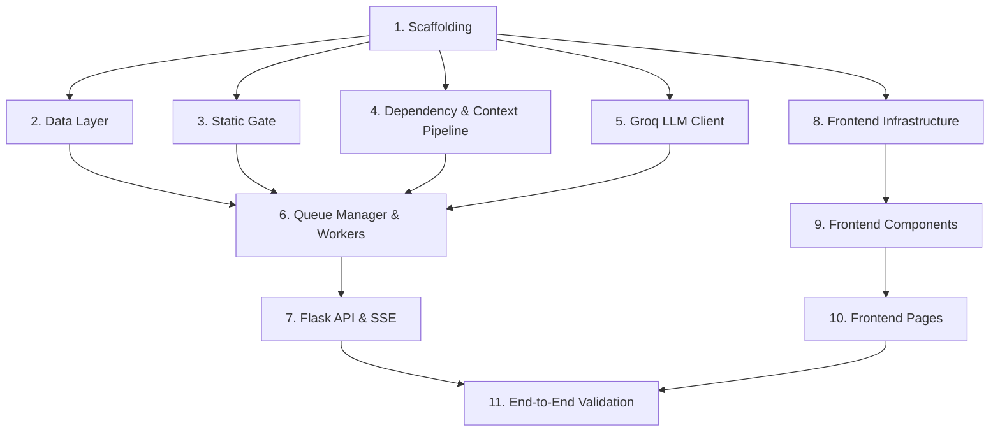

# Implementation Plan: PR Verification Engine

## Overview

This plan builds the PR Verification Engine in 11 sequential task groups, following the natural dependency order: data layer first, then pipeline stages, then the queue/worker layer that orchestrates them, then the Flask API, then the Next.js frontend on top. End-to-end validation is last.

The prototype is scoped for a 5-hour build day, so each task group maps to roughly 20–30 minutes of focused work. Tasks within a group can often be done in parallel by two developers.

## Task Dependency Graph



```json
{
  "waves": [
    {"id": 1, "tasks": ["1.1", "1.2", "1.3", "1.4", "1.5"]},
    {"id": 2, "tasks": ["2.1", "2.2", "2.3", "2.4", "2.5", "2.6", "3.1", "3.2", "3.3", "3.4", "3.5", "4.1", "4.2", "4.3", "4.4", "4.5", "4.6", "5.1", "5.2", "5.3", "5.4", "5.5", "5.6", "8.1", "8.2", "8.3"]},
    {"id": 3, "tasks": ["6.1", "6.2", "6.3", "6.4", "6.5", "6.6", "6.7", "9.1", "9.2", "9.3", "9.4"]},
    {"id": 4, "tasks": ["7.1", "7.2", "7.3", "7.4", "7.5", "7.6", "7.7", "7.8", "10.1", "10.2"]},
    {"id": 5, "tasks": ["11.1", "11.2", "11.3", "11.4", "11.5"]}
  ]
}
```

## Tasks

### 1. Project Scaffolding and Configuration

- [ ] 1.1 Create the backend directory structure: `backend/`, `backend/pipeline/`, `backend/llm/`, `backend/sample_repo/`
- [ ] 1.2 Create the frontend directory structure using `npx create-next-app@14` with TypeScript and Tailwind CSS in `frontend/`
- [ ] 1.3 Create `backend/requirements.txt` listing `flask`, `flask-cors`, `groq`, `python-dotenv`
- [ ] 1.4 Create `backend/.env.example` with `GROQ_API_KEY=your_key_here` as documentation
- [ ] 1.5 Create `backend/sample_repo/auth.py`, `backend/sample_repo/payments.py`, and `backend/sample_repo/utils.py` with realistic stub functions (e.g., `authenticate_user`, `process_payment`, `validate_card`) used by integration tests and the demo simulator

### 2. Data Layer — SQLite Database

- [ ] 2.1 Implement `backend/models.py` with `PRStatus` enum, `PRSubmitRequest`, `PRJobRow`, `CacheRow`, `PRJobInsert`, and `CacheInsert` dataclasses matching the schema defined in the design
- [ ] 2.2 Implement `backend/db.py` `Database` class with `init_schema()` that creates `pr_jobs` and `review_cache` tables (with all columns and indices) using `CREATE TABLE IF NOT EXISTS`
- [ ] 2.3 Implement `Database.insert_job(job: PRJobInsert) -> int` using a parameterized INSERT and returning the new `rowid`
- [ ] 2.4 Implement `Database.update_job_status(job_id, status, **fields)` with a `threading.Lock` guard, accepting optional keyword fields (`review`, `static_result`, `cost_usd`, `latency_ms`, `cache_hit`, `started_at`, `completed_at`, `prompt_tokens`, `completion_tokens`)
- [ ] 2.5 Implement `Database.get_job(job_id) -> PRJobRow | None`, `Database.get_all_jobs() -> list[PRJobRow]`, and `Database.get_queued_jobs_for_pr(pr_number) -> list[PRJobRow]`
- [ ] 2.6 Implement `Database.get_cache(commit_sha) -> CacheRow | None` and `Database.insert_cache(row: CacheInsert)` with a unique-constraint-safe `INSERT OR IGNORE`

### 3. Static Gate Pipeline

- [ ] 3.1 Implement `backend/pipeline/static_gate.py` with the `GateResult` and `CheckResult` dataclasses
- [ ] 3.2 Implement `_scan_secrets(diff: str) -> CheckResult` using the 5 compiled regex patterns (`AWS_ACCESS_KEY`, `AWS_SECRET_KEY`, `JWT_TOKEN`, `API_KEY_GENERIC`, `PRIVATE_KEY`); scan only lines starting with `+`
- [ ] 3.3 Implement `_check_syntax(diff: str) -> CheckResult` by extracting `+`-prefixed lines per file hunk (split on `+++` markers) and calling `ast.parse` on each block
- [ ] 3.4 Implement `run_static_gates(diff, repo_root=None) -> GateResult` wrapping both checks with `time.perf_counter()` for `duration_ms`, short-circuiting on first failure
- [ ] 3.5 Write unit tests in `backend/tests/test_static_gate.py` covering: clean diff passes, AWS key detected, JWT detected, Python syntax error detected, pattern on context line (not `+`) does not trigger

### 4. Dependency and Context Pipeline

- [ ] 4.1 Implement `backend/pipeline/dependency.py` `_extract_imports(source: str) -> list[str]` using `ast.walk` to collect `Import` and `ImportFrom` node names
- [ ] 4.2 Implement `_resolve_local(import_name, repo_root) -> str | None` checking `os.path.join(repo_root, import_name + ".py")` existence
- [ ] 4.3 Implement `resolve_dependencies(changed_files, repo_root="sample_repo") -> list[str]` capped at 3 results, skipping unparseable files
- [ ] 4.4 Implement `backend/pipeline/context_builder.py` `SymbolContext` dataclass and `read_symbol_context(file_path, symbols) -> list[SymbolContext]` using `ast.walk` to find `FunctionDef`, `AsyncFunctionDef`, and `ClassDef` nodes; cap each at 60 source lines
- [ ] 4.5 Implement `build_context_prompt(diff, symbol_contexts) -> str` assembling system instructions + diff block + code snippets; enforce `len(result) // 4 < 4000` by dropping symbol contexts from the end when over budget
- [ ] 4.6 Write unit tests in `backend/tests/test_pipeline.py` covering: `resolve_dependencies` with `sample_repo/`, symbol extraction caps at 60 lines, prompt budget enforcement

### 5. Groq LLM Client

- [ ] 5.1 Implement `backend/llm/groq_client.py` with `Finding` and `LLMReview` dataclasses and custom exceptions `GroqRateLimitError` and `GroqAPIError`
- [ ] 5.2 Implement `GroqClient.__init__(api_key, model="llama-3.3-70b-versatile")` loading the Groq SDK client
- [ ] 5.3 Implement `GroqClient.review(prompt: str) -> LLMReview` calling `client.chat.completions.create` with a system prompt instructing JSON-only output; parse the response and populate all `LLMReview` fields
- [ ] 5.4 Implement `GroqClient._compute_cost(prompt_tokens, completion_tokens) -> float` using the published per-token rates for `llama-3.3-70b-versatile`
- [ ] 5.5 Implement the JSON fallback in `review()`: if `json.loads` raises, return `LLMReview(summary=raw_text, findings=[], severity="low", prompt_tokens=..., completion_tokens=..., cost_usd=...)`
- [ ] 5.6 Write unit tests in `backend/tests/test_groq_client.py` with mocked HTTP responses: 200 valid JSON, 200 invalid JSON (fallback), 429 raises `GroqRateLimitError`, 500 raises `GroqAPIError`

### 6. Queue Manager and Worker Pool

- [ ] 6.1 Implement `backend/queue_manager.py` `QueueManager.__init__(db, num_workers=3)` initialising `queue.Queue`, a worker thread registry dict, and `ThreadPoolExecutor`; submit `_worker_loop` for each of the 3 workers
- [ ] 6.2 Implement `QueueManager.enqueue(job_id: int)` that (a) checks for any `QUEUED` jobs with the same `pr_number` and marks them `SUPERSEDED`, then (b) puts `job_id` on the queue
- [ ] 6.3 Implement `QueueManager.cancel(job_id: int) -> bool` returning `False` if the job is not in `QUEUED` status, otherwise marking it `SUPERSEDED`
- [ ] 6.4 Implement `QueueManager.get_worker_status() -> list[WorkerStatus]` returning `{worker_id, status, current_job_id}` for each of the 3 workers
- [ ] 6.5 Implement `QueueManager._worker_loop(worker_id)` pulling job IDs from the queue, checking for `SUPERSEDED` early exit, and calling `_run_pipeline`
- [ ] 6.6 Implement `_run_pipeline(job, db, worker_id)` executing all 6 pipeline stages in order (cache check → static gate → dependency resolution → symbol context → LLM call → persist) with correct status transitions and `emit_sse_event` calls
- [ ] 6.7 Implement `_call_llm_with_backoff(prompt, max_retries=5)` with the exponential backoff loop: catch `GroqRateLimitError`, sleep `min(2^attempt, 32)` seconds, retry up to 5 times, raise on exhaustion

### 7. Flask API and SSE

- [ ] 7.1 Implement `backend/app.py` with Flask app factory, `flask-cors` configured for `http://localhost:3000`, and `python-dotenv` loading `.env` on startup
- [ ] 7.2 Implement `POST /api/pr/submit`: validate body fields (required: `pr_number`, `title`, `commit_sha`, `diff`, `files`), enforce `len(diff) <= 100_000`, call `db.insert_job`, call `queue_manager.enqueue`, return `202 {"job_id": int}`
- [ ] 7.3 Implement `POST /api/pr/batch`: validate body is a list of 1–20 items, return `422` with `batch_size_exceeded` if over 20, insert and enqueue all valid jobs, return `202 {"jobs": [...]}`
- [ ] 7.4 Implement `GET /api/pr/<int:job_id>`: return full `PRJobDetail` (including `diff`, `static_result`, `review`) or `404`
- [ ] 7.5 Implement `GET /api/queue/status`: return `workers`, `jobs` (all), and computed `aggregate` stats
- [ ] 7.6 Implement the SSE registry (`_sse_queues` list + `_sse_lock`), `emit_sse_event(job_id, status)`, and `GET /api/stream` using `stream_with_context` with 15-second keepalive pings
- [ ] 7.7 Implement `DELETE /api/pr/<int:job_id>`: call `queue_manager.cancel`, return `200` on success, `409` if already terminal, `404` if not found
- [ ] 7.8 Write integration tests in `backend/tests/test_api.py` using Flask test client: submit → 202, batch over 20 → 422, cancel queued → 200, cancel terminal → 409, get non-existent → 404

### 8. Frontend — Core Infrastructure

- [ ] 8.1 Create `frontend/lib/api.ts` with all TypeScript types (`PRJob`, `PRJobDetail`, `QueueStatus`, `ReviewResult`, `Finding`, `WorkerStatus`, `Aggregate`) and async fetch functions: `fetchQueueStatus()`, `fetchJobDetail(id)`, `submitPR(payload)`, `submitBatch(payloads)`, `cancelJob(id)`
- [ ] 8.2 Create a custom React hook `frontend/lib/useSSE.ts` that opens an `EventSource` to `/api/stream`, parses events, and returns a `Map<number, PRStatus>` of live status overrides; closes the connection on unmount
- [ ] 8.3 Configure `frontend/next.config.ts` with an API proxy rewrite: `{ source: '/api/:path*', destination: 'http://localhost:5000/api/:path*' }` so the Next.js dev server forwards API calls to Flask

### 9. Frontend — Components

- [ ] 9.1 Implement `frontend/components/TelemetryBadge.tsx`: given a `PRJob`, display a compact badge showing `latency_ms`, `prompt_tokens`, `completion_tokens`, `cost_usd` (formatted as `$0.000000`), and a "Cache Hit" pill when `cache_hit=true`
- [ ] 9.2 Implement `frontend/components/QueueTable.tsx`: a table rendering all `PRJob[]` rows with status colour-coding (QUEUED=gray, AI_REVIEWING=blue, COMPLETED=green, STATIC_FAILED=red, SUPERSEDED=orange), live status from `useSSE`, and a link to the detail page; include a workers panel showing 3 worker status indicators (idle/busy)
- [ ] 9.3 Implement `frontend/components/DiffViewer.tsx`: render the unified diff with syntax-highlighted lines (`+` lines green, `-` lines red); overlay `Finding` annotations at the line numbers specified in `review.findings`
- [ ] 9.4 Implement `frontend/components/BatchSimulator.tsx`: a form with a number input (1–20) and a "Submit Batch" button that generates synthetic PR payloads with random commit SHAs and calls `submitBatch`; show a loading state during submission

### 10. Frontend — Pages

- [ ] 10.1 Implement `frontend/app/page.tsx` as the queue monitor: fetch `GET /api/queue/status` on mount, subscribe to SSE, render `QueueTable` and an aggregate stats bar (total jobs, total cost, cache hit %, avg latency); render `BatchSimulator`
- [ ] 10.2 Implement `frontend/app/pr/[id]/page.tsx` as the PR detail page: fetch `GET /api/pr/:id` on mount, subscribe to SSE for live status updates, render `DiffViewer` for `COMPLETED` jobs, render static findings for `STATIC_FAILED` jobs, and show a status spinner for in-progress jobs

### 11. End-to-End Validation

- [ ] 11.1 Manually verify the happy path: start Flask + Next.js, submit a single PR via the UI, confirm status transitions appear live via SSE, and confirm the detail page shows review findings and telemetry
- [ ] 11.2 Manually verify the cache path: submit the same `commit_sha` twice, confirm the second job completes instantly with `cache_hit=true` and `cost_usd=$0.00` in the UI
- [ ] 11.3 Manually verify the static gate: submit a diff containing an AWS key pattern, confirm the job reaches `STATIC_FAILED` without an LLM call and the detail page shows the secret scan finding
- [ ] 11.4 Manually verify batch + supersede: use `BatchSimulator` to submit 5 PRs where 2 share the same `pr_number`, confirm the older one is shown as `SUPERSEDED` in the queue table
- [ ] 11.5 Manually verify aggregate telemetry: after running the above scenarios, confirm the stats bar shows correct totals for `total_cost_usd`, `cache_hit` count, and `avg_latency_ms`

## Notes

- **Backend test runner**: use `pytest backend/tests/` from the `backend/` directory. For a single-pass run (no watch mode), `pytest backend/tests/ -v`.
- **Frontend dev server**: run `npm run dev` manually in the `frontend/` directory. Do not start it from an automated task.
- **Flask dev server**: run `flask --app app run --port 5000` manually in the `backend/` directory. Do not start it from an automated task.
- **GROQ_API_KEY**: must be set in `backend/.env` before running any task that invokes the LLM client. Tasks 5 and 6 can be unit-tested without it via mocked HTTP responses.
- **SQLite file**: the database file `pr_engine.db` is created at the `backend/` working directory on first Flask startup. It is safe to delete and recreate during development.
- **Sample repo**: `backend/sample_repo/` contains realistic Python stubs (`auth.py`, `payments.py`, `utils.py`) used both by the dependency resolver in production and by fixture-based tests.
- **Thread safety**: all `Database` write operations must hold `self._lock` (a `threading.Lock`). Never call `db` methods from worker threads without the lock.
- **Cost precision**: `cost_usd` is stored as REAL (float64 in SQLite). Format it as `$0.000000` (6 decimal places) in the UI to handle sub-cent amounts accurately.
