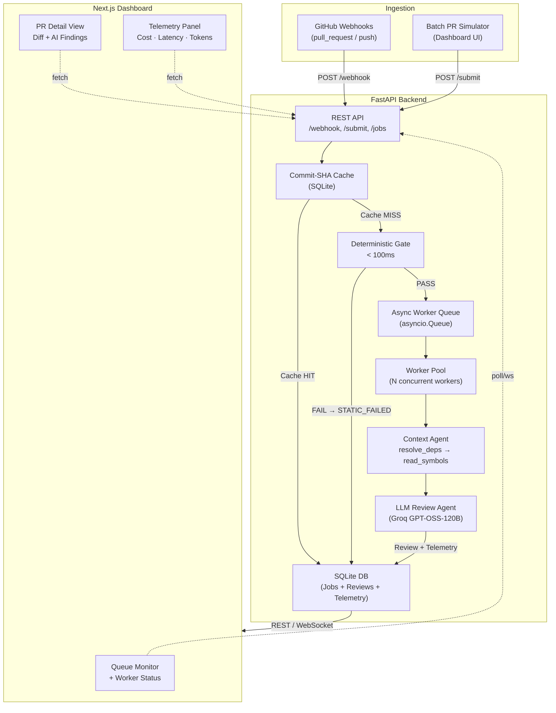
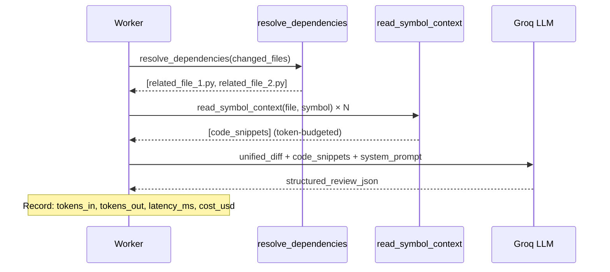
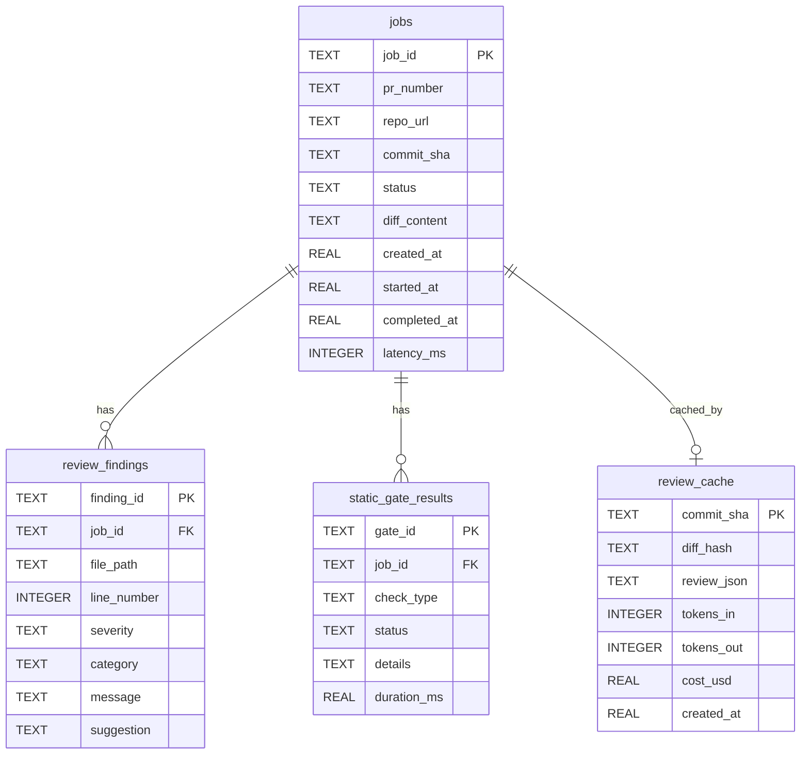

# 🚀 High-Throughput Git PR Verification & Context Engine — Project Planner

> **Team:** Shubh Solanki · Chirag Mahajan · Rohan Hulli
> **Build Window:** 5 Hours (10:00 AM → 3:00 PM Code Freeze) · November 23, 2026
> **Status:** 🟢 APPROVED — All decisions finalized. Ready to code.

---

## 1. Problem Statement

Engineering teams merging dozens of Pull Requests per hour face **two failure modes** with naive AI code review:

| Failure Mode | Root Cause | Impact |
|---|---|---|
| **Token Cost Explosion** | Feeding entire repositories into LLM prompts | \$100s in wasted API spend per day, unusable latencies (30s+ per review) |
| **Queue Stalling** | Synchronous, sequential PR processing | Traffic bursts cause cascading delays; developers wait 10–15 min for review during peak merge windows |

**The gap:** No existing lightweight tool combines *zero-cost deterministic pre-filtering*, *surgical context gathering*, and *async parallel processing* with real-time cost visibility — all in a self-hosted, dashboard-driven package.

---

## 2. Product Goal

> Build a **continuous, high-throughput PR Verification & Review Platform** where incoming PRs pass through zero-cost deterministic checks first, enter an asynchronous worker queue with commit-level caching, and use a surgical context-gathering agent to inspect only the diff and its direct dependencies — all monitored through a live operations dashboard with per-PR cost and latency telemetry.

### Core Principle
This is a **background worker service with a live monitoring UI** — not a single-PR script. Every PR must track its full job lifecycle and expose real telemetry.

---

## 3. Requirements Breakdown

### 3.1 Strict Requirements (Must-Have for Demo)

These are non-negotiable deliverables required by the PRD for the 3:00 PM code freeze.

| ID | Requirement | Acceptance Criteria |
|---|---|---|
| **S1** | **Job Lifecycle State Machine** | Every PR tracks states: `QUEUED` → `STATIC_FAILED` / `AI_REVIEWING` → `COMPLETED` / `SUPERSEDED`. State transitions are persisted in SQLite. |
| **S2** | **Deterministic Gate (< 100ms)** | Pre-LLM pipeline runs: (a) regex secret scanning (AWS keys, JWTs, API tokens), (b) syntax/lint checks, (c) unit test runner hooks. Failing PRs terminate with `STATIC_FAILED` and **zero LLM spend**. |
| **S3** | **Surgical Context Bounding** | LLM prompt contains **only** the unified diff + directly dependent code slices (imports, function defs, callers). Never the entire repo tree. |
| **S4** | **Commit-SHA Dedup Cache** | SQLite cache keyed by `commit_sha` (or diff content hash). Submitting the same SHA twice returns the cached review instantly with 0 tokens consumed. |
| **S5** | **Async Parallel Worker Pool** | Multiple PRs process concurrently via `asyncio.Queue` workers. No blocking between independent PRs. |
| **S6** | **PR Supersession** | Pushing a new commit to an in-progress PR either cancels the stale job or cleanly supersedes it — no duplicate/stale review comments. |
| **S7** | **Cost & Latency Telemetry** | Every completed PR record stores: wall-clock duration (ms), input tokens, output tokens, calculated USD cost. All surfaced in the UI. |
| **S8** | **Live Dashboard** | Web UI with: (a) Queue monitor + worker concurrency status + PR lifecycle states, (b) PR detail view with diff + inline AI findings, (c) Per-PR & aggregate telemetry, (d) Cache hit badge. |
| **S9** | **Batch PR Simulator** | UI control to submit 1 or 20+ concurrent PRs to stress-test the pipeline. |
| **S10** | **GitHub Webhook Listener** | Real endpoint receiving GitHub `pull_request` and `push` webhook events to ingest PRs into the queue. |

### 3.2 Loose Requirements (Should-Have / Nice-to-Have)

Stretch goals that strengthen the demo but can be descoped if time is tight.

| ID | Requirement | Priority | Notes |
|---|---|---|---|
| **L1** | Exponential backoff on LLM rate limits | Should-Have | Improves resilience during batch bursts |
| **L2** | Real-time WebSocket push to dashboard | Should-Have | Alternative: polling every 2s |
| **L3** | Structured review output (severity, category, line number) | Should-Have | Makes AI findings more actionable |
| **L4** | Dark mode / polished UI styling | Nice-to-Have | Low priority vs. functionality |
| **L5** | Aggregate analytics (avg latency, total cost, cache hit rate) | Should-Have | Good for demo impact |
| **L6** | Multi-repo support | Nice-to-Have | Out of scope for 5-hour build |
| **L7** | GitHub status check / comment write-back | Nice-to-Have | Would require GitHub App auth |
| **L8** | Worker auto-scaling (dynamic pool size) | Nice-to-Have | Static pool sufficient for demo |

---

## 4. Planned Architecture

### 4.1 High-Level System Diagram



### 4.2 Layer-by-Layer Breakdown

#### Layer 1 — Ingestion

| Component | Tech | Responsibility |
|---|---|---|
| GitHub Webhook Endpoint | FastAPI `POST /webhook` | Receives `pull_request` (opened/synchronize) and `push` events. Validates `X-Hub-Signature-256`. Extracts repo, PR number, head SHA, diff URL. |
| Batch Simulator | Next.js UI + `POST /api/submit` | Lets a user submit N synthetic PRs at once. Generates realistic diffs from the sample Python repo. |
| Manual Submit | FastAPI `POST /submit` | Accepts a JSON payload with repo path, file changes, and commit SHA for direct testing. |

#### Layer 2 — Deterministic Gate

| Check | Implementation | Failure Output |
|---|---|---|
| **Secret Scanning** | Regex patterns for `AKIA[0-9A-Z]{16}`, `eyJ` JWT prefixes, `sk-`, `ghp_`, generic `API_KEY=` | List of matched secrets with file + line |
| **Syntax Check** | `py_compile` / AST parse on changed `.py` files | Syntax error message + file |
| **Lint (optional)** | `ruff` or `flake8` on diff-only lines (stretch) | Lint violations |

> [!IMPORTANT]
> The gate must complete in **< 100ms** and **never** call the LLM. Any failure here → job goes straight to `STATIC_FAILED` with zero API cost.

#### Layer 3 — Queue & Worker Pool

| Component | Detail |
|---|---|
| **Queue** | `asyncio.Queue` with configurable max size. Each item is a `JobContext` dataclass (job_id, repo_path, diff, sha, pr_number). |
| **Workers** | N async worker coroutines (default N=3) pulling from the queue. Each worker handles one PR end-to-end (context → LLM → persist). |
| **Dedup Cache** | Before queueing, check `commit_sha` in SQLite `review_cache` table. On HIT → return cached result, mark `COMPLETED (cached)`. |
| **Supersession** | On new commit for same PR number, mark older in-progress job as `SUPERSEDED` and cancel its worker task if still running. |
| **Backoff** | On LLM 429/rate-limit, exponential backoff (1s → 2s → 4s → max 30s) with jitter. Max 3 retries before marking `FAILED`. |

#### Layer 4 — Context & Review Agent



**Tools available to the agent:**

| Tool | Purpose | Token Impact |
|---|---|---|
| `run_static_gates(diff)` | Pre-filter (runs in Gate layer) | Saves 100% LLM cost on broken PRs |
| `resolve_dependencies(files)` | Parse imports + symbol refs → list of related file paths | Excludes unrelated files |
| `read_symbol_context(file, sym)` | Extract specific function/class defs referenced in diff | Keeps context within strict token budget |
| `check_commit_cache(sha)` | SQLite lookup by SHA before invoking workers | 0 tokens on cache hit |

#### Layer 5 — Frontend Dashboard

| View | Key Elements |
|---|---|
| **Queue Monitor** | Real-time list of all jobs with state badges (`QUEUED` / `AI_REVIEWING` / `COMPLETED` / `STATIC_FAILED` / `SUPERSEDED`), worker utilization bar, queue depth counter |
| **PR Detail** | Side-by-side or unified diff view, inline AI review comments anchored to line numbers, severity indicators (Critical / Warning / Info) |
| **Telemetry Panel** | Per-PR: latency ms, input/output tokens, USD cost, cache hit badge. Aggregate: avg latency, total cost, cache hit rate chart |
| **Batch Simulator** | Slider or input (1–20 PRs), "Fire" button, progress indicators |

---

## 5. Data Model (SQLite Schema)



---

## 6. Tech Stack Summary

| Layer | Technology | Rationale |
|---|---|---|
| **Backend** | Python 3.11+ / FastAPI | Native `asyncio`, first-class type hints, matches PRD's `asyncio.Queue` spec |
| **Worker Queue** | `asyncio.Queue` + `asyncio.Task` pool | Zero external dependencies, sufficient for demo scale |
| **Database** | SQLite (via `aiosqlite`) | File-based, zero-config, adequate for single-instance demo |
| **LLM Provider** | Groq — GPT-OSS-120B | User-specified. Fast inference via Groq's LPU. Fallback: Gemini Flash |
| **Frontend** | Next.js 14 (App Router) | SSR capability, API routes co-located, React ecosystem |
| **Real-time** | WebSocket (FastAPI → Next.js) or polling | Should-have: WebSocket. Fallback: 2s polling |
| **Styling** | Tailwind CSS + shadcn/ui | Rapid, professional UI components |
| **Sample Repo** | Small Python project (3–5 modules) | Testable import resolution, matches backend stack |

---

## 7. Project Highlights & Demo Impact Points

| Highlight | Why It Matters |
|---|---|
| 🛡️ **Zero-cost deterministic gate** | Broken PRs never touch the LLM. Instant feedback, \$0 cost. |
| 🔬 **Surgical context bounding** | Only diff + direct deps enter the prompt → 10–50× fewer tokens than naive whole-repo approach. |
| ⚡ **Async parallel workers** | 3+ PRs reviewed simultaneously. No queue stalling during burst submissions. |
| 💰 **Per-PR cost telemetry** | Real-time USD cost tracking per review — proves ROI to engineering leads. |
| 🔁 **Commit-SHA caching** | Duplicate SHAs return instantly. Saves tokens and wall-clock time. |
| 🧹 **PR supersession** | New commits auto-cancel stale reviews — no wasted compute or confusing old comments. |
| 📊 **Live operations dashboard** | Not a CLI tool — a production-grade monitoring UI with batch stress-testing built in. |
| 🔗 **Real GitHub webhook integration** | Accepts actual GitHub events — not just simulated payloads. |

---

## 8. Scalability Controls

| Dimension | Current (Demo) | Scale Path |
|---|---|---|
| **Concurrent workers** | 3 (asyncio tasks) | → Celery/Redis workers across N machines |
| **Queue** | In-process `asyncio.Queue` | → Redis Streams or RabbitMQ for distributed queue |
| **Database** | SQLite (single-file) | → PostgreSQL with connection pooling |
| **Cache** | SQLite table lookup | → Redis with TTL-based eviction |
| **LLM provider** | Single (Groq GPT-OSS-120B) | → Provider-agnostic adapter (Groq / Gemini / OpenAI) with failover |
| **Repo support** | Single sample repo | → Multi-repo registry with per-repo config |
| **Auth** | None (local demo) | → GitHub App OAuth + webhook signature verification |
| **Deployment** | `uvicorn` local | → Docker Compose → Kubernetes |
| **Telemetry** | SQLite + UI queries | → Prometheus metrics + Grafana dashboards |
| **Context engine** | Python import parsing | → Language Server Protocol (LSP) for multi-language support |

> [!TIP]
> For the 5-hour build, every component is chosen for **zero external infra** (no Redis, no Postgres, no Docker required). The scale path exists but is explicitly out of scope.

---

## 9. Suggested 3-Person Role Split

```mermaid
flowchart LR
    subgraph Person_A["👤 Shubh Solanki — Backend Core\n(Queue + Workers + DB)"]
        A1["FastAPI server setup\nRoutes: /webhook, /submit, /jobs"]
        A2["asyncio.Queue + Worker Pool"]
        A3["SQLite schema + aiosqlite"]
        A4["Commit-SHA cache logic"]
        A5["Job state machine\n+ supersession"]
        A6["WebSocket broadcast"]
    end

    subgraph Person_B["👤 Chirag Mahajan — Gate + Context Agent\n(Intelligence Layer)"]
        B1["Deterministic Gate\nsecrets, syntax, lint"]
        B2["resolve_dependencies()\nimport parser"]
        B3["read_symbol_context()\nAST extraction"]
        B4["LLM Review Agent\nprompt + structured output"]
        B5["Token counting\n+ cost calculation"]
        B6["Sample Python repo\n+ test PR diffs"]
    end

    subgraph Person_C["👤 Rohan Hulli — Frontend Dashboard\n(Next.js UI)"]
        C1["Next.js project scaffold\nTailwind + shadcn/ui"]
        C2["Queue Monitor view\njob cards + state badges"]
        C3["PR Detail view\ndiff + inline findings"]
        C4["Telemetry panel\nper-PR + aggregate"]
        C5["Batch PR Simulator\nslider + fire button"]
        C6["WebSocket / polling\nreal-time updates"]
    end

    Person_A ---|REST API contract| Person_C
    Person_A ---|job pipeline| Person_B
```



### Integration Points & Contracts

| Contract | Shubh provides | Chirag/Rohan consumes |
|---|---|---|
| **Job API** | `POST /submit`, `GET /jobs`, `GET /jobs/{id}`, `WS /ws` | Frontend polls/subscribes; Gate + Agent are called by workers |
| **Gate Interface** | Worker calls `run_static_gates(diff) → GateResult` | Chirag implements the function |
| **Context Interface** | Worker calls `resolve_deps(files) → [paths]`, `read_symbols(file, sym) → snippets` | Chirag implements both |
| **LLM Interface** | Worker calls `review_pr(diff, context) → ReviewResult` | Chirag implements with Groq SDK |
| **DB Schema** | Shubh creates tables, provides `db.py` helper | All use the shared schema |

> [!IMPORTANT]
> **Hour 0 (10:00–10:30):** All three people must align on the API contract and DB schema before splitting. Define the JSON shapes for `JobResponse`, `GateResult`, `ReviewResult`, and `FindingItem` together.

---

## 10. Timeline (5-Hour Build)

| Window | Shubh (Backend) | Chirag (Gate + Agent) | Rohan (Frontend) |
|---|---|---|---|
| **10:00–10:30** | SQLite schema DDL, FastAPI scaffold, API route stubs | Sample Python repo (3–5 modules), secret patterns list | Next.js scaffold, page routes, Tailwind setup |
| ⬇️ | *Sync: agree on JSON contracts + DB schema* | | |
| **10:30–12:15** | Worker pool, queue, cache, supersession, `/submit` + `/webhook` endpoints, job state machine | Deterministic gate (secrets + syntax), `resolve_dependencies`, `read_symbol_context` | Queue Monitor page, Job list with state badges, polling/WS hook |
| **12:15–1:45** | WebSocket broadcast, telemetry persistence, `/jobs` detail endpoint, Groq integration glue | LLM review agent (prompt engineering, structured output, token/cost accounting) | PR Detail view (diff + findings), Telemetry panel, Batch Simulator |
| **1:45–3:00** | Concurrency stress test, edge cases (supersession, rate limits), bug fixes | End-to-end pipeline testing, prompt tuning, cache verification | Polish UI, aggregate stats, final integration testing |

---

## 11. Risk Register

| Risk | Likelihood | Impact | Mitigation |
|---|---|---|---|
| Groq API rate limits during batch test | Medium | High | Exponential backoff + small batch size for demo. Have Gemini Flash as fallback. |
| Import/dependency parser fails on edge cases | Medium | Medium | Keep parser simple (regex + AST). Hardcode fallback dependency map for sample repo. |
| WebSocket complexity eats time | Low | Medium | Fallback to 2-second polling. Implement WS only if ahead of schedule. |
| GitHub webhook setup complexity | Medium | Medium | Using `ngrok` for local tunneling (confirmed). Batch Simulator as fallback demo path if ngrok has issues. |
| SQLite write contention under concurrency | Low | Medium | Use WAL mode + `aiosqlite` with single writer pattern. |
| 5-hour window is tight | High | High | Prioritize strict requirements (S1–S9). Cut loose requirements (L4–L8) first. |

---

## 12. Finalized Decisions

> [!TIP]
> All open items have been resolved. The team is clear to begin coding.

- [x] **Role assignment:** Shubh → Backend Core (A), Chirag → Gate + Context Agent (B), Rohan → Frontend Dashboard (C)
- [x] **Groq API key:** Confirmed — team has a working key for GPT-OSS-120B.
- [x] **GitHub webhook approach:** Use `ngrok` for local tunneling to receive real GitHub webhook events.
- [x] **Repo structure:** Monorepo with `/backend` and `/frontend` folders.
- [ ] **Worker pool size:** Default 3 workers — adjust at runtime if needed.
- [ ] **Token budget per review:** Suggest 4K tokens of context + diff — tune during integration.
- [ ] **Additional static gate rules:** Secrets + syntax at minimum. Lint via `ruff` as stretch.

---

## 13. Monorepo Structure

```
ATX-PR-Engine/
├── backend/
│   ├── main.py                  # FastAPI app entry (Shubh)
│   ├── config.py                # Settings, env vars, Groq key
│   ├── db.py                    # SQLite schema + aiosqlite helpers (Shubh)
│   ├── models.py                # Pydantic models: JobResponse, GateResult, ReviewResult, FindingItem
│   ├── queue_manager.py         # asyncio.Queue + worker pool + supersession (Shubh)
│   ├── webhook.py               # GitHub webhook handler + signature validation (Shubh)
│   ├── gates/
│   │   ├── __init__.py
│   │   ├── secret_scanner.py    # Regex secret detection (Chirag)
│   │   ├── syntax_checker.py    # py_compile / AST parse (Chirag)
│   │   └── gate_runner.py       # Orchestrates all gates (Chirag)
│   ├── context/
│   │   ├── __init__.py
│   │   ├── dependency_resolver.py  # Import/symbol parser (Chirag)
│   │   └── symbol_reader.py     # AST-based function/class extractor (Chirag)
│   ├── agent/
│   │   ├── __init__.py
│   │   ├── review_agent.py      # LLM prompt + Groq SDK call (Chirag)
│   │   └── token_tracker.py     # Token counting + cost calc (Chirag)
│   ├── sample_repo/             # Test Python project with realistic modules (Chirag)
│   │   ├── app.py
│   │   ├── auth.py
│   │   ├── database.py
│   │   ├── utils.py
│   │   └── tests/
│   └── requirements.txt
├── frontend/
│   ├── app/                     # Next.js App Router (Rohan)
│   │   ├── page.tsx             # Queue Monitor (home)
│   │   ├── pr/[id]/page.tsx     # PR Detail view
│   │   └── layout.tsx
│   ├── components/
│   │   ├── QueueMonitor.tsx     # Job cards + state badges (Rohan)
│   │   ├── PRDetail.tsx         # Diff viewer + inline findings (Rohan)
│   │   ├── TelemetryPanel.tsx   # Cost, latency, tokens (Rohan)
│   │   ├── BatchSimulator.tsx   # Slider + fire button (Rohan)
│   │   └── StatusBadge.tsx      # QUEUED/COMPLETED/etc badges
│   ├── lib/
│   │   └── api.ts               # Fetch/WS helpers for backend
│   ├── package.json
│   └── tailwind.config.ts
├── .env                         # GROQ_API_KEY, NGROK_AUTH, etc.
├── .gitignore
└── README.md
```

---

*This planner is finalized and approved. The team is ready to begin coding.*
